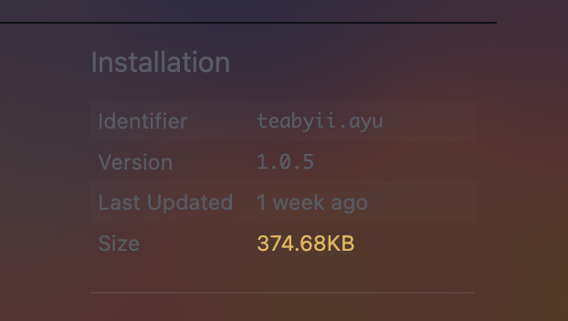
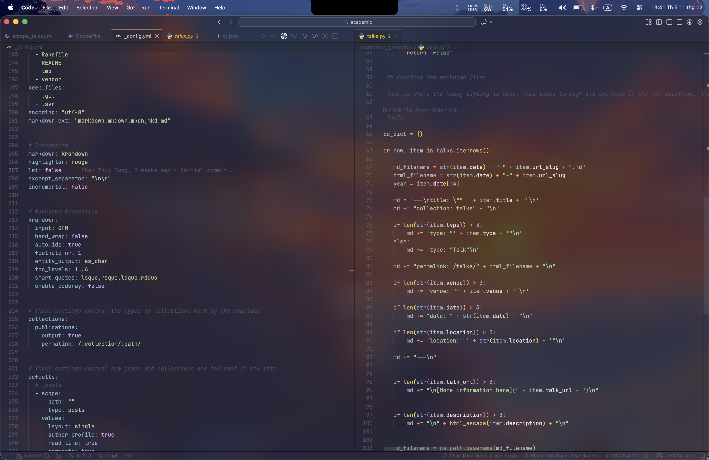

# VSCode_CustomTheme

This is a custom VSCode theme based on the Ayu theme, enhanced with additional CSS and JavaScript customizations using the Vibrancy extension.

## Installation and Usage

To use this theme in VSCode:

1. Install the "Vibrancy" extension from the VSCode marketplace.

2. Install a base theme (e.g., Ayu Dark) if you haven't already.

3. Open VSCode settings and navigate to the Vibrancy extension settings.

4. To access the theme code, follow the steps shown in the image below:
   

5. Copy the contents of `ayu_theme.json` and paste it into the theme file location shown.

6. Reload the Vibrancy extension in the VSCode settings.

7. The result should look like this:
   