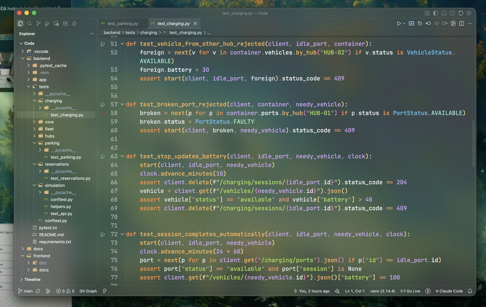
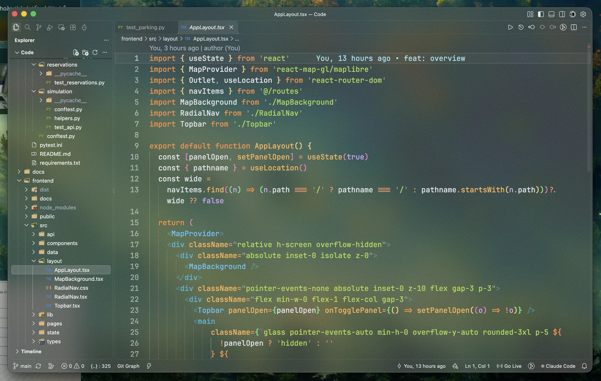

# VS Code Transparent Frosted Glass Setup Guide

A complete, beginner-friendly guide to recreating this modern frosted glass (macOS Vibrancy) aesthetic with floating pill-shaped directory items, crisp typography, and ruby neon accents in Visual Studio Code.


*Figure 1: Complete setup showcasing ultra-dark macOS vibrancy, pill-shaped directory selection, and high-contrast JetBrains Mono typography.*

---

## 1. Requirements

- macOS (10.14 Mojave or newer, Apple Silicon or Intel)
- Visual Studio Code (latest official release)
- Administrator privileges on macOS (required for enabling custom Electron vibrancy)

---

## 2. Step 1: Install Required Extensions

Open VS Code, press `Cmd + Shift + X` to open the Extensions marketplace, then search and install the following extensions:

1. **Apc Customize UI++** (Extension ID: `drcika.apc-extension`)
   - Provides native Electron vibrancy blur, custom font loading, and stylesheet injection.
2. **Transparent Color Theme** (Extension ID: `alexowl.transparent-color-theme`)
   - Provides a clean transparent theme foundation.
3. **vscode-icons** (Extension ID: `vscode-icons-team.vscode-icons`)
   - Provides rich, colorful file and folder icons for clear directory navigation.
4. **VSCode Animations** (Extension ID: `brandonkirbyson.vscode-animations`)
   - Adds smooth UI animations across tabs and panels.

Alternatively, you can install them via terminal:

```bash
code --install-extension drcika.apc-extension
code --install-extension alexowl.transparent-color-theme
code --install-extension vscode-icons-team.vscode-icons
code --install-extension brandonkirbyson.vscode-animations
```

---

## 3. Step 2: Install Recommended Fonts

To ensure code text remains bold, sharp, and easy to read over transparent blurred backgrounds:

1. Download **JetBrains Mono** from the official site: https://www.jetbrains.com/lp/mono/
2. Unzip and open the font files, then click **Install Font** in macOS Font Book.
3. macOS includes **SF Pro Display** by default, which is used for the sidebar UI font.

---

## 4. Step 3: Apply the Configuration File

### Method A: Copy File Directly

Copy the provided `settings.json` file to the VS Code User settings folder:

```bash
cp ./settings.json ~/Library/Application\ Support/Code/User/settings.json
```

### Method B: Manual Paste

1. Open VS Code.
2. Press `Cmd + Shift + P` to open the Command Palette.
3. Type: `Preferences: Open User Settings (JSON)` and press `Enter`.
4. Replace the entire content of that file with the content of `settings.json` from this folder.
5. Save the file (`Cmd + S`).

---

## 5. Step 4: Activate Apc Customize UI++ & Restart

To allow the Apc extension to patch the Electron window for native macOS ultra-dark vibrancy:

1. In VS Code, press `Cmd + Shift + P`.
2. Type: `Enable Apc extension` and press `Enter`.
3. If prompted for administrator permissions, enter your macOS password.
4. When prompted, click **Restart** (or press `Cmd + Shift + P` -> `Developer: Reload Window`).

---

## 6. Key Design Elements


*Figure 2: TypeScript/React layout featuring elevated tabs, colorful icons, and vibrant syntax highlighting.*

### Uniform Frosted Glass Transparency
- All panels (Editor, Primary Sidebar, Auxiliary Claude Bar, Tabs strip, Status Bar, Breadcrumbs) use `#00000000` (transparent).
- Electron vibrancy is configured to `ultra-dark` with `0.95` opacity, delivering a uniform macOS backdrop blur across the entire window.

### Pill-Shaped Directory Items (macOS Finder Style)
- Explorer rows use a custom Apc stylesheet rule:
  ```css
  .monaco-list-row {
    border-radius: 6px !important;
    margin: 0 4px !important;
    width: calc(100% - 8px) !important;
  }
  ```
- Hovering and active selection appear as floating rounded pills instead of full-width sharp boxes.

### High-Contrast Typography for Transparent Backgrounds
- Font: `JetBrains Mono` at `fontWeight: "500"` (Medium) and `fontSize: 18`.
- Thicker letter strokes eliminate the hazy or washed-out appearance caused by font anti-aliasing against photographic wallpapers.
- Primary text color set to `#f5f7fa` for clear readability.
- Dim comment color upgraded to `#8ea0b5` for readable GitLens annotations.

### Elevated Frosted Active Tab
- The active tab has a subtle translucent frosted background (`#ffffff14`) with a top ruby border (`#F33246`).
- Inactive tabs remain recessed (`#00000010`) with thin glass dividers (`#ffffff0e`).

### Subtle Line Highlight Glow
- `editor.renderLineHighlight: "all"` creates a light glass strip (`#ffffff08`) with a 1px border (`#ffffff14`) following the cursor.

### Ruby Red Accents
- Neon ruby `#F33246` is used for the text cursor, bracket match borders, active tab indicator, and Git notification badges.
- Cursor width is set to `3px` with smooth caret animations.

### Slim 8px Scrollbars
- Scrollbars are constrained to `8px` width with rounded slider corners, keeping the transparent layout uncluttered.

---

## 7. Troubleshooting

### Transparency does not appear after restarting
- Ensure you ran `Enable Apc extension` from the Command Palette and granted permission.
- Make sure `window.titleBarStyle` is set to `"custom"`.
- Verify macOS System Settings -> Desktop & Dock -> ensure Mission Control / Stage Manager is not forcing full opacity.

### Extension prompts a corrupt installation warning
- Because the Apc extension patches VS Code's internal Electron files to enable vibrancy, VS Code may display an `Unsupported installation` warning banner.
- You can click the gear icon on the notification and choose **Don't Show Again**.

### How to revert back to default
- To revert, delete or restore your backup from:
  `~/Library/Application Support/Code/User/settings.json`
- In Command Palette, run `Disable Apc extension` and reload VS Code.
